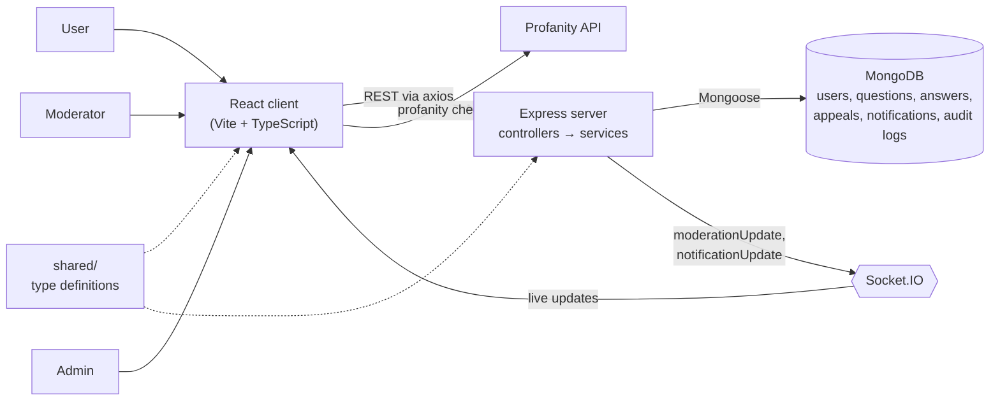
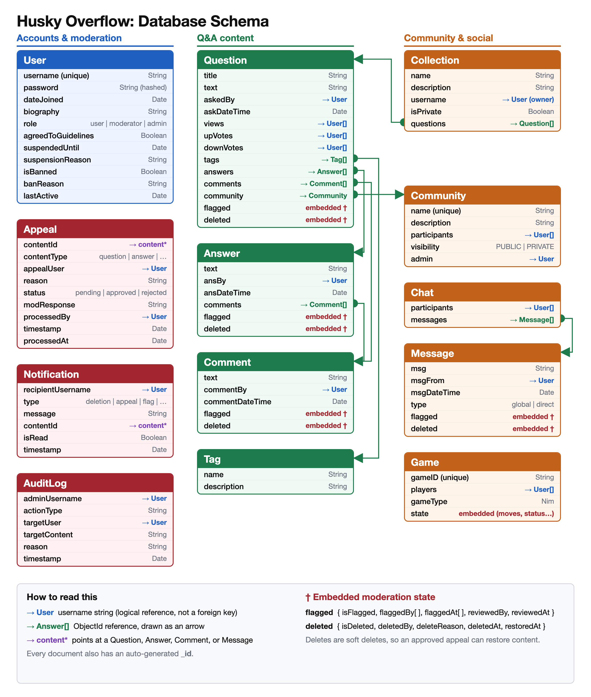

# Husky Overflow

**A full-stack Stack Overflow-style Q&A platform with built-in moderation, appeals, and admin tooling.**

Developed over a semester by Ahana, Dishant, and Anika for CS 4530: Fundamentals of Software Engineering. The team extended a course-provided "Fake Stack Overflow" starter codebase with new features across three user roles: users, moderators, and admins.

<small>This README is AI generated and checked by me.</small>

---

## How it works

Husky Overflow supports three roles, each with their own views and permissions once they log in.

**Users**: Users can ask questions, answer them, comment, vote, tag, join communities, save questions to collections, message each other, and chat with a built-in help chatbot. They agree to community guidelines at signup, can flag content, and can appeal if their content is removed.

**Moderators**: Moderators get a dashboard of flagged and appealed content. They can delete content (with a written reason), review or dismiss flags, approve or reject appeals, and see their own deletion history.

**Admins**: Admins get a platform dashboard with live metrics and an audit log. They can create, edit, delete, suspend, ban, promote, and demote users.

### The moderation lifecycle

A piece of content moves through a defined flow, and every step notifies the people involved in real time:

1. A user **flags** a question, answer, or comment (one flag per user per item).
2. A moderator **reviews** it: dismiss the flag, or **delete** it with a reason of at least three words.
3. The author gets an instant **deletion notification** containing the reason.
4. The author can submit **one appeal** per deletion.
5. A moderator **approves** (content is restored) or **rejects** the appeal, and the author is notified of the result.

Full user stories and step-by-step test instructions for every feature are in [FEATURES.md](FEATURES.md).

---

## Tech stack

| Layer | Technology |
| --- | --- |
| Language | TypeScript (client, server, and shared types) |
| Frontend | React, Vite, React Router, Recharts |
| Backend | Node.js, Express, express-openapi-validator |
| Database | MongoDB with Mongoose |
| Realtime | Socket.IO |
| Testing | Jest, Cypress (end-to-end), cypress-axe (accessibility), Stryker (mutation testing) |
| CI | GitHub Actions: lint, build, server smoke test, backend and frontend tests |

---

## Architecture



The repo is an npm workspace with three packages:

- `client`: the React frontend (components, hooks, services).
- `server`: the Express API, Mongoose models and schemas, services, seed data, and OpenAPI spec.
- `shared`: TypeScript types used by both client and server, so the API contract stays consistent.

On the server, each feature follows a **controller → service → model** layering: controllers handle HTTP and socket events, services hold the business logic and database access, and models define the Mongoose schemas. On the client, each screen pairs a component with a custom hook that owns its state and calls a service module for API access.

The database schema is defined in `server/models/schema`. This diagram reflects the current Mongoose schemas, including the moderation, appeal, notification, and audit-log collections added this semester.

[](schema-diagram.png)

*Click the image to view it full size.*

A few things worth knowing about how the schema works:

- **Users are referenced by username**, not by `ObjectId`. Content, votes, appeals, and notifications store the username string, so the `USER` links above are logical rather than enforced foreign keys.
- **Moderation state is embedded.** Questions, answers, comments, and messages each carry a `flagged` object (`isFlagged`, `flaggedBy[]`, `flaggedAt[]`, `reviewedBy`, `reviewedAt`) and a `deleted` object (`isDeleted`, `deletedBy`, `deleteReason`, `deletedAt`, `restoredAt`). Deleting is a soft delete, which is what lets an approved appeal restore the content.
- **Appeals and notifications point at content polymorphically.** `contentId` can reference a question, answer, comment, or message, and `contentType` says which.

---

## Anika's contribution

I owned most of the **moderation, appeals, and admin user-management** workflow, plus several user-facing features around it.

### Features

**Moderator deletion, history, and appeals.** I built the appeal flow end to end: authors can appeal a deletion once, and moderators can approve or reject from the dashboard. Rejections and approvals trigger instant notifications to the author, and approved appeals restore the content. I also added the moderator's **deletion history** view, the three-word minimum for deletion reasons, and the deletion notifications that include the removed content and reason.

**Admin user management.** Admins can suspend users for a set number of days with a violation reason, ban them, promote or demote users between User, Moderator, and Admin, and create, edit, or delete accounts from the dashboard. Every route checks that the caller is an admin, and a suspension or ban is checked at login so the user is redirected to a suspended page.

**Real-time moderation updates.** Moderation routes emit `moderationUpdate` and `notificationUpdate` Socket.IO events, so dashboards and notification bells update without a refresh.

**Community guidelines.** The guidelines page, agreement at signup, access from the profile, and a check that users have agreed before they participate.

**Profanity detection.** Questions, answers, comments, and messages are checked against a profanity API before submission, for all roles including moderators. Failed checks surface as clear form errors.

**Duplicate question detection.** While a user types a question, a debounced hook searches by title, text, and tags and shows up to five similar questions, which reduces duplicate posts.

**Dark mode.** A theme toggle in the header that persists the preference between sessions, applied through a `ThemeContext` and a shared `darkmode.css`.

**API spec and tests.** I kept `openapi.yaml` in sync with the new routes, wrote Jest unit tests for the services, controllers, and hooks I added, and wrote the workflow documentation in FEATURES.md.

### Patterns and skills

| Pattern | Where |
| --- | --- |
| Layered backend: controller → service → model | moderation, user, notification, and admin features |
| Role-based access control | admin and moderator checks in every protected route, plus client route guards |
| Realtime sync | Socket.IO events for moderation and notifications |
| Custom React hooks for state and data | `useModeratorDashboard`, `useUserManagement`, `useSimilarQuestions`, `useTheme` |
| React Context | `ThemeContext` for dark mode, `UserContext` for the logged-in user |
| Contract-first API validation | OpenAPI spec enforced by `express-openapi-validator` |
| Debounced search | similar-question suggestions (500 ms) |
| Testing | Jest for units, Cypress workflows for moderation, appeals, and admin flows |
| Team workflow | feature branches, pull requests, merge-conflict resolution, linting in CI |

---

## Running it locally

You'll need Node.js 22 and a running MongoDB instance.

```bash
# install dependencies for client, server, and shared
npm install

# server (in /server): set MONGODB_URI, e.g. mongodb://127.0.0.1:27017
npm run populate-db   # optional: load sample data
npm run dev

# client (in /client): set VITE_SERVER_URL, e.g. http://localhost:8000
npm run dev
```

Seed logins for the admin and moderator accounts are listed in [FEATURES.md](FEATURES.md).

To run the tests:

```bash
cd server && npm test
cd client && npm test
```

---

## API routes

The full API is described in [`server/openapi.yaml`](server/openapi.yaml). All routes are served under `/api` (for example `/api/moderation/flagged`), and interactive docs are at `/api/docs`. The main route groups are:

| Group | Purpose |
| --- | --- |
| `/user` | signup, login, profile, guidelines agreement, suspend, ban, promote, demote |
| `/moderation` | delete, flag, unflag, review, dismiss, appeals, deleted-content history, restore |
| `/admin` | dashboard metrics, audit logs, create user |
| `/notification` | list, unread count, mark read, delete |
| `/question`, `/answer`, `/comment`, `/tags` | core Q&A |
| `/community`, `/collection`, `/message`, `/chat`, `/chatbot`, `/games` | community and social features |

---

## AI disclosure

The application was architected by our team and the course professors. A significant amount of the code and tests was written with AI assistance.

---

## Repository history

This repo is a copy of a private class repo that was created for this project. This repo preserves the commit history of `main` but removes private information, including a committed npm cache, and rewrites commit author emails to GitHub noreply addresses.
